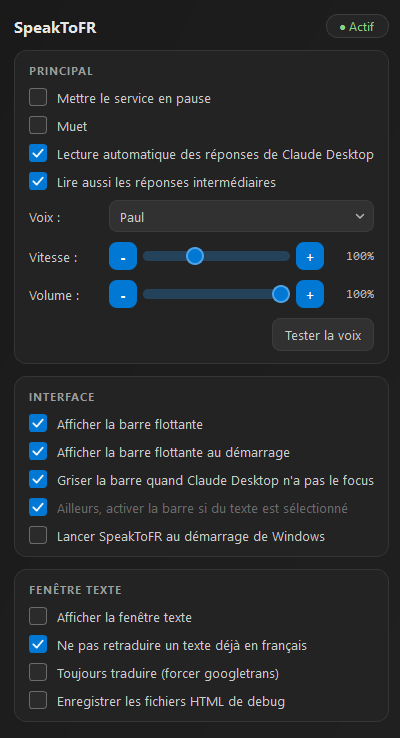

# SpeakToFR

Lecture vocale en français pour Windows. SpeakToFR lit à voix haute :

- **les réponses de Claude Desktop**, automatiquement, dès qu'elles sont terminées ;
- **n'importe quel texte sélectionné** dans une autre appli, avec le raccourci <kbd>Ctrl</kbd>+<kbd>Alt</kbd>+<kbd>Entrée</kbd>.

Un texte dans une autre langue est d'abord traduit en français. Ensuite, il est lu phrase par phrase avec une voix Windows (OneCore).


## Fonctionnalités

- **Claude Desktop** : chaque nouvelle réponse est lue dès qu'elle est terminée. Pendant que Claude travaille, ses textes intermédiaires et ses lignes d'étape (sauf les lignes d'outil comme « Utilisant… ») sont lus au fil de l'eau, à la suite, sans couper la lecture en cours. La fin de la réponse est lue sans répéter ce qui l'a déjà été. Quand tu ouvres ou changes de conversation, sa dernière réponse est chargée sans être lue, et le prochain Play la lit.
- **Sélection** : <kbd>Ctrl</kbd>+<kbd>Alt</kbd>+<kbd>Entrée</kbd> copie la sélection et la lit. Si le presse-papiers contient du HTML, SpeakToFR l'utilise de préférence.
- **Traduction** vers le français avec googletrans. Un texte déjà en français n'est pas retraduit, sauf si tu forces la traduction. Les morceaux d'une sélection HTML (liens, gras, listes…) partent ensemble, en une requête par bloc d'environ 4 500 caractères. Les traductions sont gardées en cache, donc relire un texte déjà traduit est instantané.
- **Lecture adaptée** : les blocs de code ne sont pas lus. Les URL, chemins Windows et sigles sont préparés pour être bien prononcés.
- **Barre flottante**, **fenêtre Options** et **fenêtre texte**, sur le modèle de l'extension VS Code [CodexAudio](https://github.com/TREHAND-Christian/CodexAudio). La fenêtre texte surligne la phrase en cours de lecture.
- **Rendu fidèle de la sélection** : la fenêtre texte affiche une sélection web comme sur la page (images, fonds, dégradés, coins arrondis, couleurs), avec le moteur Chromium de Qt WebEngine. Les cartes d'un fil d'actualités sont remises côte à côte. Les scripts de la page ne s'exécutent pas et un clic sur un lien l'ouvre dans ton navigateur. Le rendu simplifié (texte seul) reste disponible dans les Options.
- **Volume et muet propres à SpeakToFR** : le volume général de Windows ne change pas.

## Barre flottante

| Bouton | Action |
|---|---|
| ▶ / ❚❚ | Lecture / pause. Si rien n'est en cours, lit la dernière réponse de Claude (ou la relit), jamais une ancienne sélection. Hors de Claude Desktop, si du texte est sélectionné, lit la sélection, comme <kbd>Ctrl</kbd>+<kbd>Alt</kbd>+<kbd>Entrée</kbd>. |
| ■ | Arrête la lecture. Grisé quand rien n'est en lecture. |
| 🔊 | Coupe ou remet le son. |
| ▤ | Affiche ou masque la fenêtre texte. Hors lecture, elle montre la dernière réponse chargée. |
| ⚙ | Ouvre les Options. |

| État | Aspect |
|---|---|
| Service actif |  |
| Service en pause (ici avec le son coupé) |  |
| Claude Desktop n'est pas au premier plan, et rien n'est sélectionné |  |

La barre est normale quand Claude Desktop est au premier plan, ou quand du texte est sélectionné dans une autre appli. Dans ce dernier cas, Play lit la sélection. La barre ne prend jamais le focus, donc l'appli garde sa sélection quand tu cliques sur Play. Sinon, la barre est grisée, mais elle reste cliquable et reprend ses couleurs au survol. Dans VS Code, c'est la barre de CodexAudio qui prend le relais. Pour déplacer la barre, il suffit de la glisser, boutons compris. Sa position est mémorisée.

## Options



La fenêtre s'ouvre avec la roue de la barre ou par un clic sur l'icône **S2FR** de la zone de notification.

- **Principal** : mettre le service en pause (coupe le raccourci et la surveillance de Claude Desktop), muet, lecture automatique des réponses de Claude Desktop, lecture des réponses intermédiaires, voix, vitesse (50 à 200 %), volume (0 à 100 %), *Tester la voix*.
- **Interface** : afficher la barre, l'afficher au démarrage, la griser hors de Claude Desktop, l'activer ailleurs si du texte est sélectionné, lancer SpeakToFR au démarrage de Windows.
- **Fenêtre texte** : l'afficher, rendu fidèle à la page ou simplifié, ne pas retraduire un texte déjà en français, toujours traduire, enregistrer les fichiers HTML de debug.

Le menu de l'icône **S2FR**, à côté de l'horloge, reprend l'essentiel de ces réglages : service actif, lecture auto de Claude Desktop, barre flottante, démarrage avec Windows, Options, Aide et Quitter.

## Installation

### Prérequis

- Windows 10 ou 11 ;
- au moins une voix française OneCore (*Paramètres > Heure et langue > Voix*), par exemple Microsoft Paul ;
- Python 3.12, pour lancer depuis les sources ou compiler ;
- facultatif : [AutoHotkey v2](https://www.autohotkey.com/), pour une copie plus fiable de la sélection.

### Lancer depuis les sources

```powershell
python -m venv .venv
.\.venv\Scripts\Activate.ps1
pip install -r requirements.txt
python main.py
```

Une seule instance peut tourner à la fois. Quitte d'abord une version installée de SpeakToFR.

### Créer l'exécutable et l'installeur

Il faut aussi PyInstaller (`pip install pyinstaller`) et [Inno Setup 6](https://jrsoftware.org/isinfo.php).

```powershell
.\build_release.ps1
```

| Résultat | Emplacement |
|---|---|
| Application (dossier) | `dist\SpeakToFR\` (`SpeakToFR.exe` + `_internal`) |
| Installeur | `Output\SetupSpeakToFR.exe` |

L'installeur installe SpeakToFR dans `Program Files (x86)\SpeakToFR`, ce qui demande les droits administrateur. Il ferme d'abord une version déjà lancée et propose le démarrage automatique avec Windows.

## Données utilisateur

Tout est rangé dans `%APPDATA%\SpeakToFR\` :

| Fichier | Contenu |
|---|---|
| `prefs.json` | Préférences (voir ci-dessous) |
| `speaktofr.log` | Journal tournant (512 Ko × 3) |
| `ui\` | Petites icônes générées pour la fenêtre Options |

Principales clés de `prefs.json` :

| Clé | Rôle |
|---|---|
| `voice`, `speed` | Voix et vitesse de lecture |
| `volume`, `muted` | Volume (0 à 100) et muet |
| `claude_auto_read`, `claude_read_partial` | Lecture automatique des réponses de Claude Desktop, et de ses réponses intermédiaires |
| `show_text` | Fenêtre texte affichée |
| `bar_x`, `bar_y`, `bar_start`, `bar_dim_unfocused`, `bar_selection_mode` | Position de la barre, affichage au démarrage, grisage hors de Claude Desktop, activation sur sélection |
| `x`, `y` | Position de la fenêtre texte |
| `text_render_faithful` | Rendu fidèle de la fenêtre texte (Chromium) ; `false` = rendu simplifié |
| `auto_detect_french`, `force_translate`, `debug_html` | Traduction et debug |

## Tests

```powershell
pip install -r requirements-dev.txt
python -m pytest tests
```

Les tests d'interface tournent sans affichage (`QT_QPA_PLATFORM=offscreen`) avec un faux moteur de synthèse vocale.

Pour vérifier la lecture de Claude Desktop sans rien lire à voix haute, lance cette commande, Claude Desktop ouvert :

```powershell
python -m codex_tts.services.claude_desktop
```

## Organisation du code

Le paquet s'appelle encore `codex_tts`, son nom historique.

| Dossier | Contenu |
|---|---|
| `main.py` | Point d'entrée : application Qt, instance unique, menu de la zone de notification, branchements |
| `codex_tts/core/` | État partagé (`state.py`), préférences, moteur OneCore, volume, logs |
| `codex_tts/playback/` | Lecture phrase par phrase (thread), pause, reprise, relance |
| `codex_tts/services/` | Claude Desktop (UI Automation), raccourci global, presse-papiers, traduction, appli au premier plan |
| `codex_tts/text/` | HTML vers texte, découpage en phrases, positions pour le surlignage, préparation de la voix |
| `codex_tts/ui/` | Barre flottante, fenêtre Options, fenêtre texte, actions communes (`app_actions.py`) |
| `tests/` | Tests pytest |

## Limites connues

- **googletrans** utilise un service non officiel : la traduction peut échouer selon le réseau. Dans ce cas, le texte d'origine est lu.
- **Claude Desktop** est lu grâce à l'accessibilité de Windows, en se basant sur les libellés de l'interface en français (« Messages de la conversation », « Claude a répondu »…). Si l'interface change ou passe dans une autre langue, il faut adapter les constantes en tête de `codex_tts/services/claude_desktop.py`.
- Le raccourci <kbd>Ctrl</kbd>+<kbd>Alt</kbd>+<kbd>Entrée</kbd> n'est pas configurable.
- Le chemin du script AutoHotkey (`codex_tts/core/config.py`) pointe encore vers `C:\Program Files\CodexTTS`. Sans lui, SpeakToFR simule simplement <kbd>Ctrl</kbd>+<kbd>C</kbd>.
